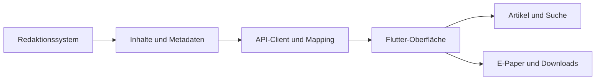

# Neues Wochenblatt

[Quellcode und Startanleitung](https://github.com/sxmxnc/regional-news-flutter) für die anonymisierte, offline nutzbare Flutter-Demo.

Eine Flutter-App für die deutsch- und polnischsprachige Regionalzeitung Neues
Wochenblatt. Die App bündelt Artikel, Galerien, Suche und digitale Ausgaben für
iOS und Android.

## Mobile Oberfläche und Schnittstellen

Die Flutter-Oberfläche gliedert die Inhalte nach Startseite, Rubriken, Suche und
E-Paper. Der App-Code trennt die Übertragung und Abbildung der API-Daten von den
Ansichten. Artikel, Rubriken und Ausgaben haben jeweils eigene Datenmodelle.

Die Sprachwahl betrifft UI-Texte und die Navigation. Für digitale Ausgaben sind
Download und Anzeige getrennt, damit die Oberfläche den Zustand eines Downloads
zeigen kann. Tests decken unter anderem die Abbildung von API-Daten und Teile
der Oberfläche ab.
